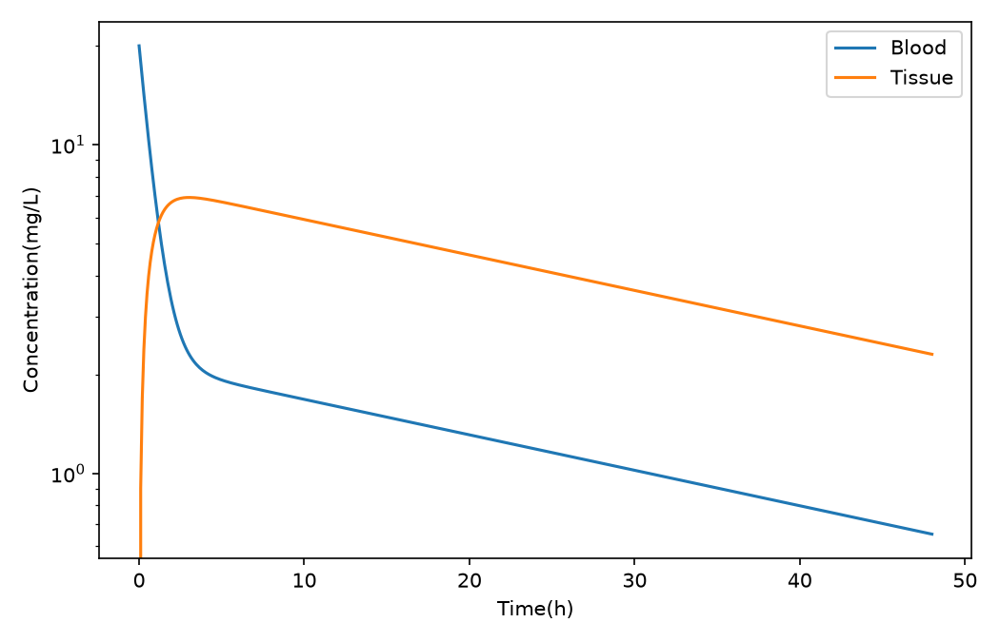
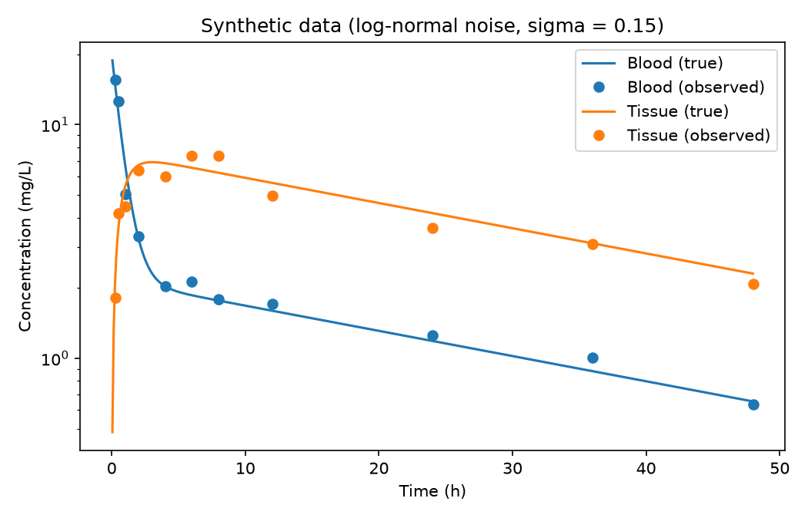
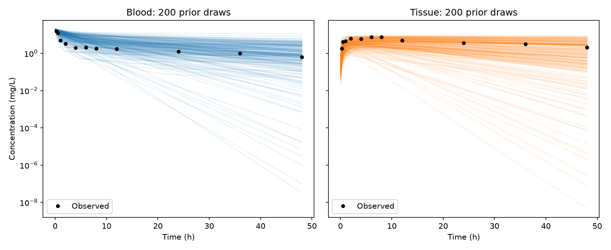
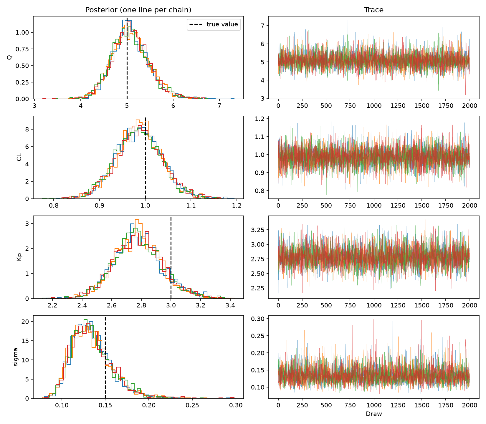
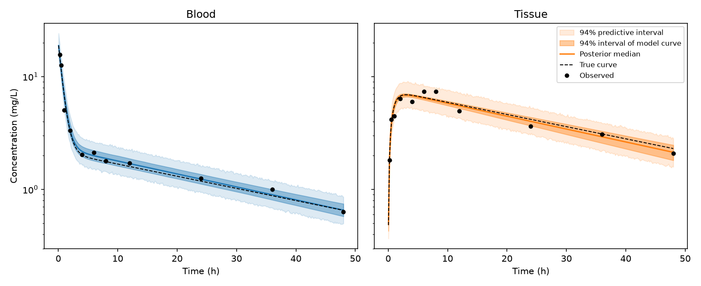
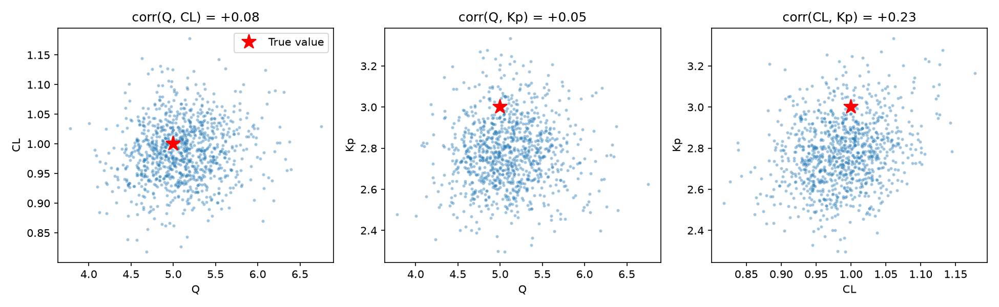
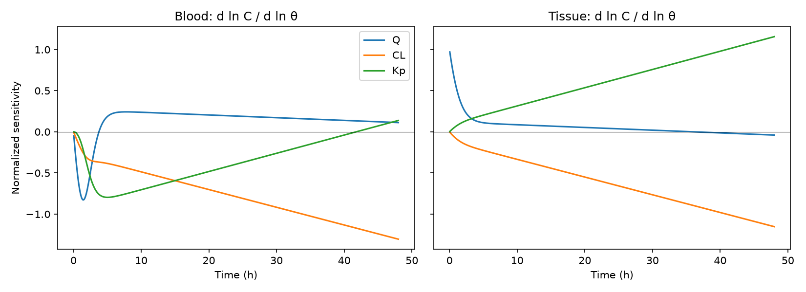
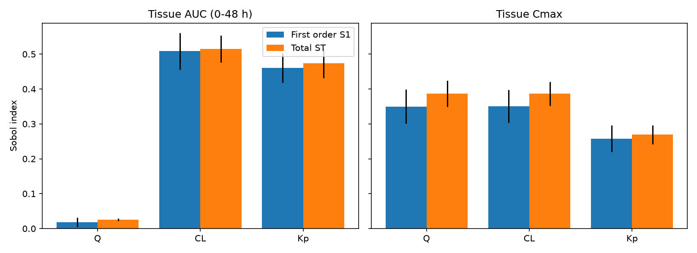
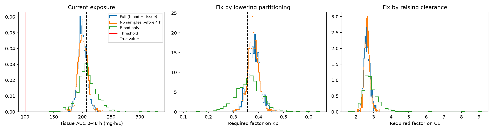

# pkbayes — Bayesian calibration, sensitivity and counterfactuals for a two-compartment transport model

A small, fully tested Python project that builds a mechanistic ODE model of
transport between blood and a tissue, calibrates it with Bayesian inference in
**PyMC**, and uses the posterior to answer two questions:

1. **Which parameters decide how much reaches the tissue?** (Sensitivity analysis)
2. **For a particle whose tissue exposure is too high, what is the smallest
   change that would fix it and when should that answer not be trusted?**
   (Counterfactual analysis under posterior uncertainty)

The model is deliberately minimal (two compartments, synthetic data) so that
every step of the workflow can be verified against known ground truth.

---

## Key findings

- **The calibration recovers all parameters** within their 94% credible
  intervals, with clean convergence diagnostics (R-hat = 1.00, bulk ESS > 6000
  of 8000 draws, 0 divergences) and a well-calibrated posterior predictive
  (21/22 observations inside the 94% predictive interval).
- **Total tissue exposure does not depend on blood flow.** Integrating the ODEs
  gives the exact identity AUC<sub>tissue</sub> = K<sub>p</sub> · dose / CL:
  partitioning and clearance decide *how much* reaches the tissue, flow only
  decides *how fast*. Global (Sobol) sensitivity confirms this numerically
  (first-order index of Q on tissue AUC ≈ 0.02).
- **The counterfactual answer is only as reliable as the data that constrain
  the parameters it depends on.** Removing early samples makes Q uncertain but
  leaves the answer unchanged, because the answer does not depend on Q.
  Observing blood only makes K<sub>p</sub> indirectly constrained and roughly
  doubles the uncertainty on the required intervention.

---

## Model

Two well-mixed compartments (blood, tissue) with perfusion-limited exchange and
elimination from blood, after an intravenous bolus:

$$
V_b \frac{dC_b}{dt} = Q\left(\frac{C_t}{K_p} - C_b\right) - CL\, C_b,
\qquad
V_t \frac{dC_t}{dt} = Q\left(C_b - \frac{C_t}{K_p}\right)
$$

| Symbol | Meaning | Unit |
|---|---|---|
| $C_b, C_t$ | concentration in blood / tissue | mg/L |
| $Q$ | blood flow through the tissue | L/h |
| $CL$ | clearance (elimination) | L/h |
| $K_p$ | tissue:blood partition coefficient | – |
| $V_b, V_t$ | compartment volumes | L |

The parametrisation is physiologically based (PBPK-style): $K_p$ is the
quantity that, for a nanoparticle, would depend on its physical and chemical
properties (size, surface, protein corona).

**Two solvers, one model.** The ODEs are solved numerically with
`scipy.integrate.solve_ivp` (reference implementation, with mass conservation
tracked as a third state). Because the system is linear, it also has a
closed-form solution in terms of the eigenvalues of the system matrix; this
version is written so that it runs both in NumPy and inside PyMC, where it is
automatically differentiable for the NUTS sampler. A test checks that the two
solutions agree to a relative tolerance of 1e-6.



The blood curve shows the two expected phases: fast distribution into the
tissue (~1.3 h⁻¹) followed by slow terminal elimination (~0.025 h⁻¹).

---

## Workflow and results

### 1. Synthetic data

Blood and tissue concentrations at 11 time points (dense early, sparse late)
with multiplicative log-normal noise (σ = 0.15, ≈15% relative error), which
keeps concentrations positive and matches typical assay error.



### 2. Bayesian model and prior predictive check

Unknowns: $Q$, $CL$, $K_p$ and the noise level $\sigma$. Volumes and dose are
treated as known, as they are set by the experimental device.
Priors are weakly informative log-normals, centred deliberately *away* from
the true values, so that recovery is driven by the data:

| Parameter | Prior | True value |
|---|---|---|
| $Q$ | LogNormal(log 2, 1) | 5 |
| $CL$ | LogNormal(log 0.5, 1) | 1 |
| $K_p$ | LogNormal(log 1, 1) | 3 |
| $\sigma$ | HalfNormal(0.5) | 0.15 |

The likelihood is Gaussian on log-concentrations, consistent with the noise model.



The priors cover the data while spanning several orders of magnitude.

### 3. Posterior: convergence and parameter recovery

NUTS, 4 chains × 2000 draws after 1000 tuning steps (~2 s thanks to the
closed-form solution).

| Parameter | True | Posterior median | 94% interval |
|---|---|---|---|
| $Q$ | 5.00 | 5.06 | [4.37, 5.89] |
| $CL$ | 1.00 | 0.99 | [0.89, 1.08] |
| $K_p$ | 3.00 | 2.77 | [2.48, 3.11] |
| $\sigma$ | 0.15 | 0.13 | [0.10, 0.19] |



$K_p$ is slightly underestimated: in this noise realisation the late tissue
observations happen to fall below the true curve, and the terminal phase is
what constrains $K_p$. The true value remains inside the interval.

### 4. Posterior predictive check and parameter correlations



The darker band is the uncertainty on the model curve (what happens in the
tissue); the lighter band adds measurement noise (where new observations are
expected). 21 of 22 observations fall inside the 94% predictive interval.



Correlations are weak (|r| ≤ 0.23) because both compartments are observed and
the sampling covers both kinetic phases. The only visible one, between $CL$ and
$K_p$, follows from the terminal rate ≈ $CL / (V_b + K_p V_t)$.

### 5. Sensitivity analysis

**Local, time-resolved** normalised sensitivities $\partial \ln C / \partial \ln \theta$
show *when* each parameter matters:



$Q$ affects the tissue only in the first few hours (it sets how fast the tissue
fills), while $K_p$ and $CL$ dominate the terminal phase with opposite signs.
This explains why early samples are needed to identify $Q$.

**Global (Sobol)** indices, with each parameter varying log-uniformly within a
factor of 3 of its nominal value (8192 model evaluations):



| Output | $Q$ (S1 / ST) | $CL$ (S1 / ST) | $K_p$ (S1 / ST) |
|---|---|---|---|
| Tissue AUC 0–48 h | 0.02 / 0.03 | 0.51 / 0.52 | 0.46 / 0.47 |
| Tissue C<sub>max</sub> | 0.35 / 0.39 | 0.35 / 0.39 | 0.26 / 0.27 |

Exposure (AUC) is governed by $K_p$ and $CL$ almost additively; the peak
concentration also depends on flow, with mild interactions.

### 6. Counterfactual: the smallest change that fixes a bad particle

Suppose a hypothetical exposure limit of 100 mg·h/L on tissue AUC (0–48 h).
The particle exceeds it (true AUC = 207). For every posterior draw, a root
finder computes the smallest multiplicative change in $K_p$ (or in $CL$) that
brings the AUC exactly to the limit. This gives a *distribution* of required
interventions rather than a single number.

To ask when the answer can be trusted, the analysis is repeated after
refitting the model on poorer experimental designs:

| Design | P(AUC > limit) | Required factor on $K_p$ (94%) | Required factor on $CL$ (94%) |
|---|---|---|---|
| Full (blood + tissue) | 1.00 | 0.38 [0.33, 0.43] | 2.61 [2.32, 2.97] |
| No samples before 4 h | 1.00 | 0.38 [0.34, 0.42] | 2.63 [2.35, 2.96] |
| Blood only | 1.00 | 0.36 [0.26, 0.47] | 2.76 [2.14, 3.85] |
| *Ground truth* | – | *0.356* | *2.785* |



- Whether the particle is problematic is clear in every design.
- Dropping early samples leaves $Q$ poorly constrained, but the counterfactual
  is unaffected, because tissue AUC does not depend on $Q$. Losing information
  matters only for the parameters a decision depends on.
- With blood-only data, $K_p$ is constrained only indirectly and the required
  intervention becomes roughly twice as uncertain, with a long tail for
  clearance. The posterior flags this by itself: a wide distribution of
  required changes is the signal not to trust a point answer.

A risk-averse decision would use an upper quantile rather than the median
(e.g. the change that keeps the AUC below the limit with 97% probability).

**Limitation.** Each counterfactual changes one parameter while keeping the
others fixed. For a real particle, changing a physical property (size,
coating) typically shifts several parameters at once; mapping particle
properties to model parameters is what would make such interventions
physically meaningful.

---

## Reproducing the results

```bash
git clone git@github.com:SilviaZironi/pkbayes.git
cd pkbayes
conda env create -f environment.yml
conda activate pkbayes

pytest                                # 15 tests
python scripts/plot_simulation.py     # figures/simulation.png
python scripts/generate_data.py       # data/, figures/data.png
python scripts/prior_predictive.py    # figures/prior_predictive.png
python scripts/fit.py                 # results/posterior.nc, results/summary.csv
python scripts/plot_diagnostics.py    # figures/trace.png
python scripts/posterior_checks.py    # posterior predictive, pair plot
python scripts/sensitivity.py         # local and Sobol sensitivity
python scripts/counterfactual.py      # counterfactual analysis
```

All random steps use fixed seeds, so the figures are reproducible.

## Repository structure

```
src/pkbayes/
    model.py           ODE right-hand side, numerical solver, closed-form solution
    data.py            synthetic observations with log-normal noise
    inference.py       data loading and PyMC model
    sensitivity.py     local sensitivities and tissue exposure metrics
    counterfactual.py  minimal parameter change to meet an exposure limit
scripts/               one script per analysis step, each saving its figures
tests/                 15 tests (see below)
data/                  synthetic dataset and ground-truth parameters
figures/               all figures shown above
results/               posterior summary and Sobol indices
```

## Tests

The tests check physics and numerics, not only that the code runs:

- mass conservation at all times, and the equilibrium ratio $C_t/C_b = K_p$ without elimination;
- agreement between the closed-form and numerical ODE solutions;
- the exact identities AUC<sub>blood</sub> = dose / CL and AUC<sub>tissue</sub> = K<sub>p</sub> dose / CL, the latter for flows spanning two orders of magnitude;
- reproducibility of the synthetic data and the statistics of the noise;
- finiteness of the model log-probability;
- correctness and direction of the counterfactual root finder.

## Author

Silvia Zironi — MSc in Nuclear and Subnuclear Physics (University of Bologna),
with a thesis on Bayesian inference and sensitivity analysis for the nuclear
three-body problem.
